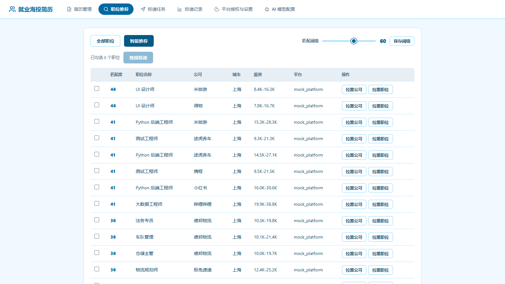
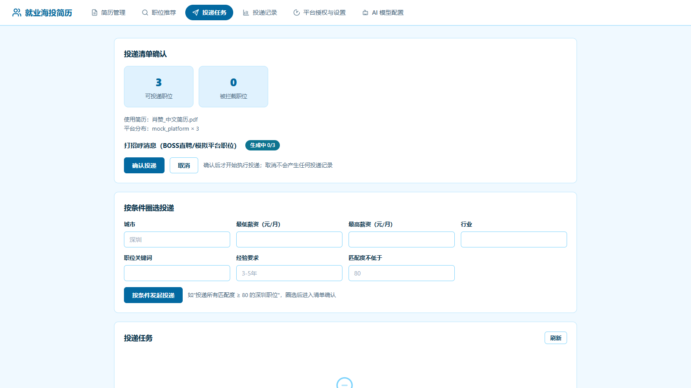
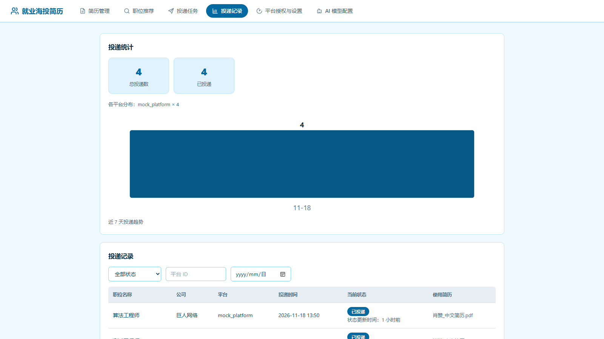
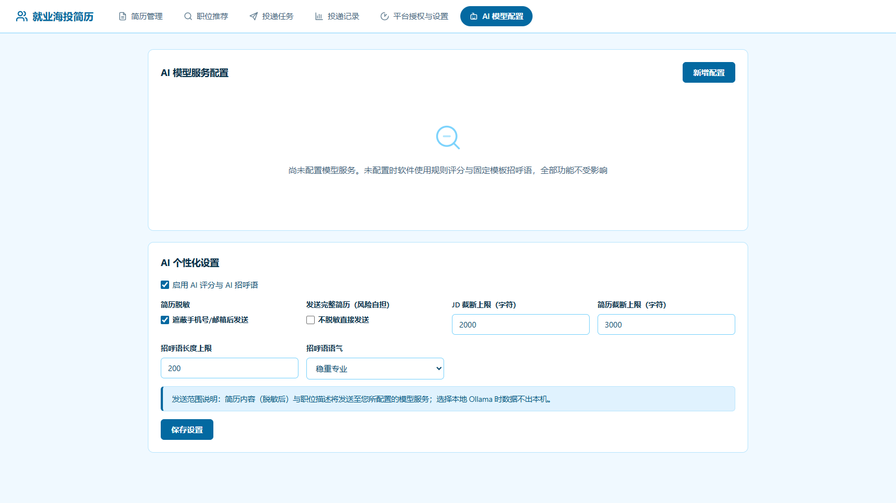

# 就业海投简历系统

**一句话价值主张**：聚合多招聘平台职位，智能匹配 + 一键批量投递，让求职海投从"手动逐份投"变成"勾选批量投"。

## 核心截图

| 职位推荐（选择式筛选 + 匹配度） | 投递清单确认 |
|---|---|
|  |  |

| 投递统计与趋势 | AI 模型配置 |
|---|---|
|  |  |

## 30 秒安装（免 Python 免安装）

1. 从 [Releases](https://github.com/xz1028/resume-mass-apply/releases) 下载分发包（`resume-mass-apply-green.zip`）
2. 解压到任意目录（支持中文与空格路径）
3. 双击 `start.bat` —— 30 秒内浏览器自动打开完整工作台

> 解压前可用 `SHA256SUMS.txt` 核对校验和；数据全部保存在解压目录 `data/`，删目录即卸载。

## 功能亮点

- **一键批量投递**：勾选或条件圈选职位 → 清单确认（拦截明细透明可见）→ 批量执行；30 天重复拦截、每日上限、平台限流、失败重试全程自动守护
- **智能匹配**：规则多因子评分开箱即用；可选接入大模型 AI 读 JD 算匹配度 + AI 生成定制招呼语（DeepSeek / 通义 / Kimi / 智谱 / 华为云磐古 / OpenAI 兼容 / 本地 Ollama 七种接入）
- **真实平台接入**（可选）：BOSS直聘 / 智联 / 前程无忧浏览器自动化投递——强制风险告知、验证码转人工、限流保守配置
- **安全设计**：简历与凭证 AES-256-GCM 加密存储、投递"先落库后发送"记录不丢失、单机数据不出本机
- **质量保障**：180+ 项单元/集成/性能测试全绿、CI 徽章持续验证
- **华为生态贴合**：内置华为云磐古大模型预设（ModelArts 端点开箱即配）；可部署至华为云 ECS/轻量服务器（见用户说明书）

## 演示模式

首次双击启动自动进入演示模式：虚构演示简历 + 593 个演示职位 + 23 条演示记录，
打开即是完整工作台（推荐/筛选/投递/统计全流程可体验）；
页面顶部横幅一键"退出演示模式"清除演示数据，随后上传真实简历开始正式使用。
演示数据经行业×岗位白名单约束生成，不含任何真实个人信息。

## 开发者指南

源码运行、API 契约、新平台适配器接入、构建发布包 → 见 [docs/developer-guide.md](docs/developer-guide.md)

## 版权声明

Copyright 2026 xz1028 —— 本项目以 [Apache License 2.0](./LICENSE) 发布，第三方组件声明见 [NOTICE](./NOTICE) 与 [docs/licenses/THIRD_PARTY.md](docs/licenses/THIRD_PARTY.md)。